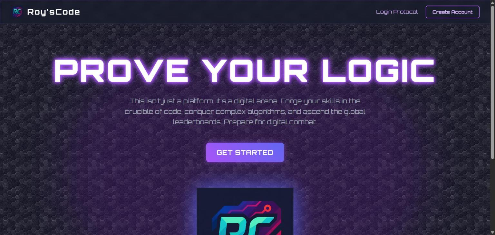
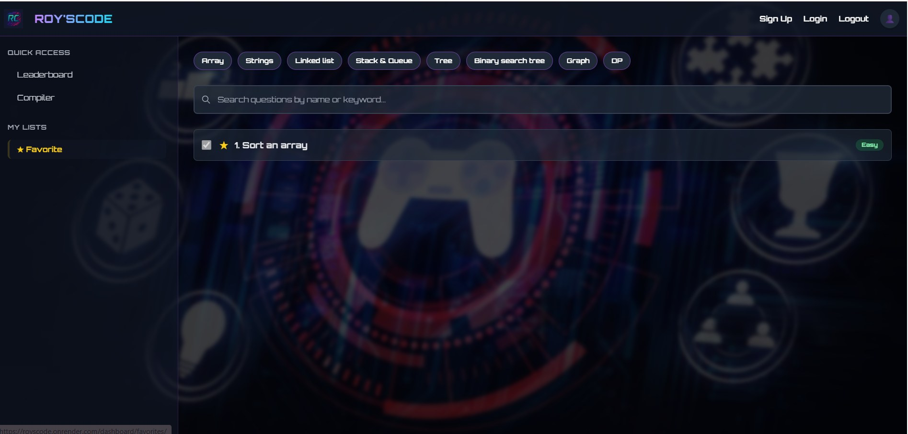
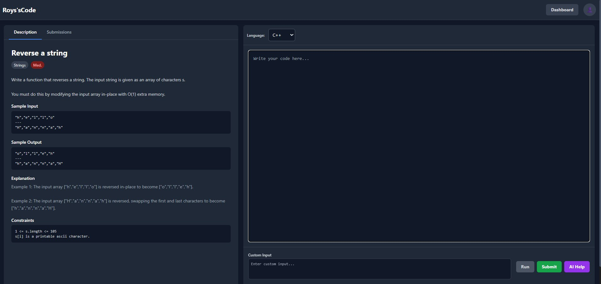
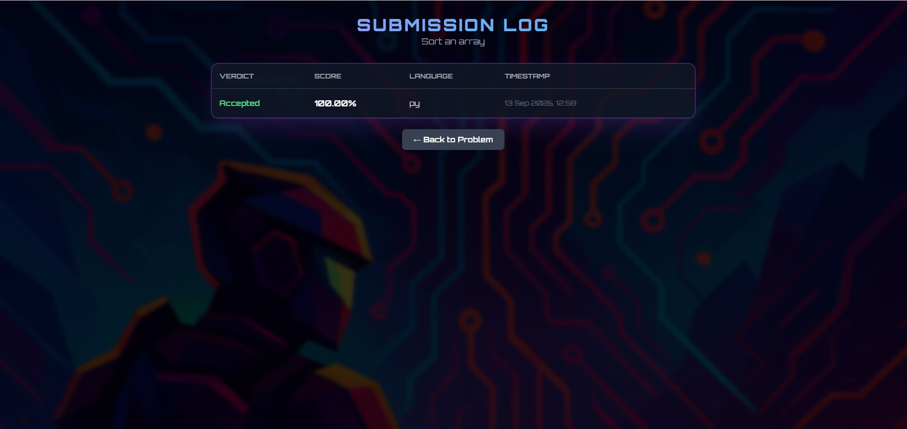
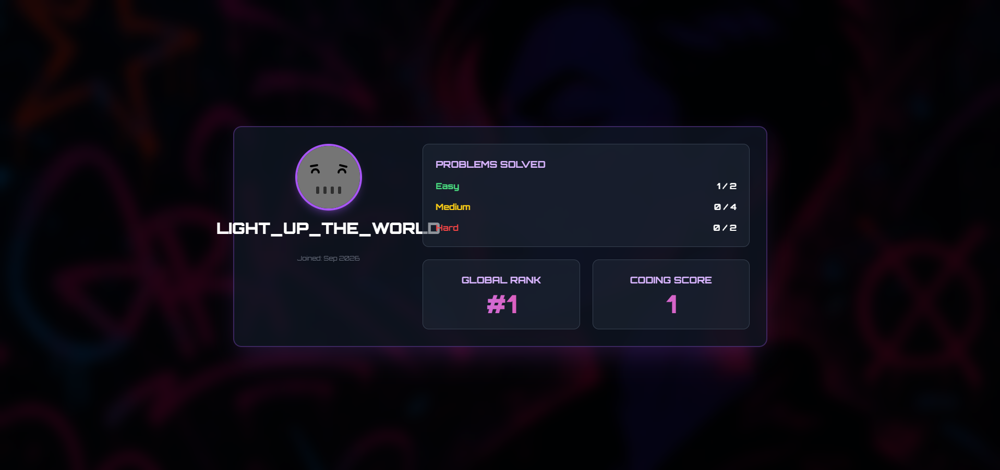
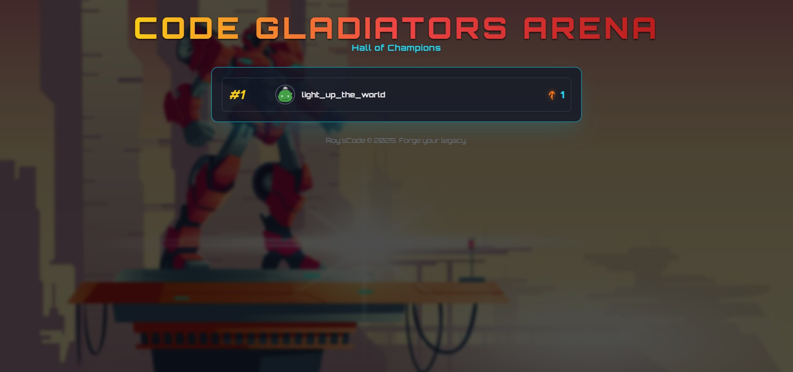
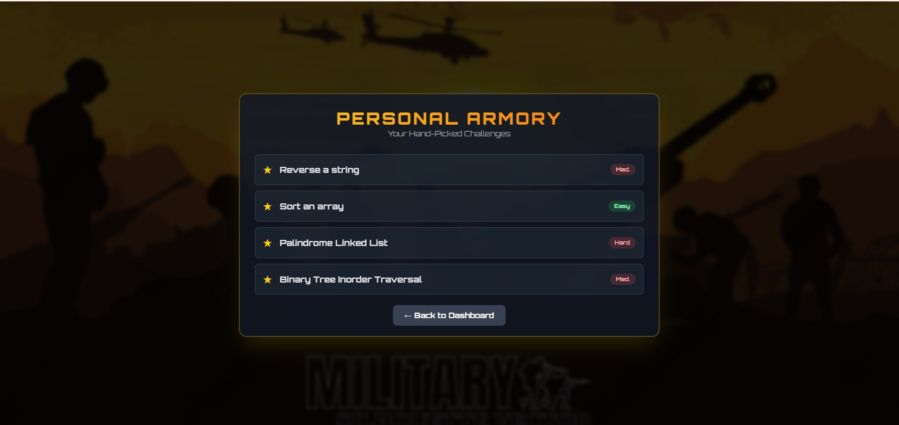
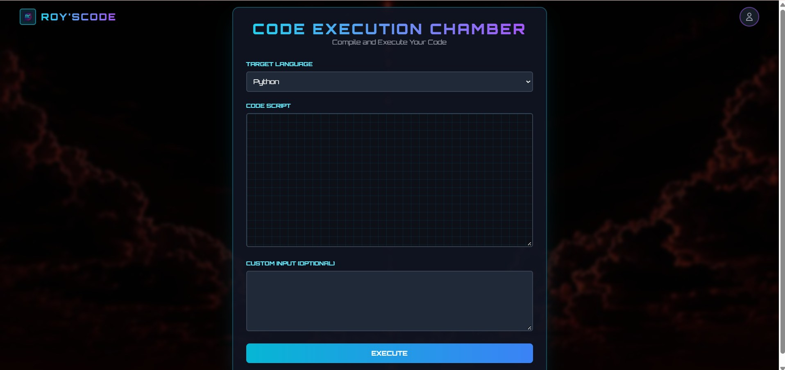
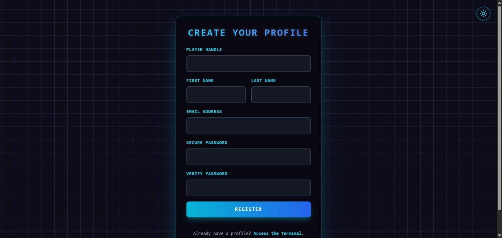

# Roy'sCode - A Tech-Themed Online Code Judge

Roy'sCode is a full-stack web application that provides a complete competitive programming platform, wrapped in an immersive and engaging Dark Tech theme. It's designed to be a comprehensive and interactive learning tool, backed by a professional, scalable, and secure cloud architecture.

---

### **[Live site: royscode-chaitanya.vercel.app](https://royscode-chaitanya.vercel.app/)** · [Demo video](https://drive.google.com/drive/folders/1wSndazeoIzb_UPJDNI1fZTUCWGoY-n-S)

**Note:** Sign up to solve problems. Every Run and Submit is compiled and executed in its own Vercel Sandbox microVM, so a verdict takes a few seconds.

---

## Screenshots

**Problem dashboard:** topic filters, search, difficulty tags, a checkmark on solved problems and a star for favourites.

**Coding arena:** problem statement, samples and constraints on the left; language picker, editor, custom input and the **Run**, **Submit** and **AI Help** buttons on the right.

**Submission log:** verdict, score, language and timestamp for every attempt at a problem.

<table>
<tr>
<td width="50%"><b>Profile</b>: problems solved by difficulty, global rank and coding score </td>
<td width="50%"><b>Leaderboard</b>: the "Hall of Champions" ranking of players </td>
</tr>
<tr>
<td width="50%"><b>Favourites</b>: starred problems in one list </td>
<td width="50%"><b>Compiler</b>: run any snippet with custom input, outside a problem </td>
</tr>
<tr>
<td width="50%"><b>Sign-up</b>: create a player profile </td>
<td width="50%"></td>
</tr>
</table>

---

## Features & Functionality

Roy'sCode is packed with features designed to create a complete and engaging user experience from login to leaderboard.

### Core User Journey & Dashboard

*   **Personalized Experience:** Users can sign up, log in, and manage a personal profile that tracks their progress and preferences.
*   **Interactive Dashboard:** The main hub for all challenges, featuring:
    -   **Topic Organization:** Problems are neatly sorted into categories like Arrays, Strings, Linked Lists, Trees, Graphs, and DP.
    -   **Difficulty Tags:** Each problem is clearly marked as Easy, Medium, or Hard.
    -   **Powerful Search:** A search bar allows users to quickly find specific problems.
*   **Automated Progress Tracking:** A key motivating feature. When a user successfully solves a problem, it gets an automatic **checkmark (✔)** on the dashboard, providing a clear visual of their accomplishments.

### The Coding Arena & Tools

*   **Integrated Solving Environment:** A clean, two-panel layout with the problem description on the left and a sleek, multi-language code editor on the right.
*   **Instant Feedback Loop:**
    -   **Run Code:** Test solutions against public sample cases for quick, iterative development.
    -   **Submit:** Send the final solution for judgment against a comprehensive suite of hidden test cases.
*   **⭐ AI-Powered Assistance:** A unique "AI Help" button is available within the problem-solving page, offering intelligent style analysis and code overview and improvements along with the Debugging analysis with the corrected code if the code is buggy.

### Community & Utility Features

*   **Live Leaderboard:** A competitive leaderboard to see how users rank against each other, fostering an engaging community.
*   **Personalized Favorites List (★):** Users can star any problem to add it to a personal favorites list for easy review and practice.
*   **Comprehensive Submission History:** A dedicated "Submissions" page where users can review the verdicts, code, and timestamps of all their past attempts.
*   **Standalone Compiler:** A separate compiler page allows users to write and run code snippets freely, outside the context of a specific problem.

---

## Tech Stack & Architecture

Roy'sCode is built on a modern, scalable technology stack, designed for performance, security, and maintainability.

-   **Backend:** Django, Gunicorn
-   **Database:** PostgreSQL
-   **Frontend:** Django Templates, HTML, Tailwind CSS
-   **DevOps & Containerization:** Docker, Docker Compose

### Cloud Architecture on AWS

The application was first deployed on Amazon Web Services, using a separated architecture for robustness and security (the public demo now runs on Vercel, see below).

-   **EC2 (Elastic Compute Cloud):** A virtual Linux server that acts as the secure host for our running Docker container.
-   **RDS (Relational Database Service):** A managed PostgreSQL database that lives independently from the application server. This ensures that all user and problem data is persistent, secure, and safely backed up.
-   **ECR (Elastic Container Registry):** A private Docker registry used to store and version our application images. This enables consistent and reliable deployments.
-   **IAM & Security Groups:** A combination of a dedicated IAM user and a strict virtual firewall ensures that the application and server are only accessible through defined, secure channels.

### Live demo on Vercel

-   **App:** Django runs as a Vercel Python Function (`api/index.py`, `vercel.json`); static files are served from Vercel's CDN.
-   **Database:** Serverless PostgreSQL on Neon, connected through `DATABASE_URL`.
-   **Code execution:** `compile/runner.py` starts a fresh Vercel Sandbox (Firecracker microVM, no network access, 1 vCPU) for each run, compiles C++ once, runs every test case with a 5 s limit, then destroys the VM. Run outside Vercel (locally or in Docker), it falls back to `g++` / `python` in a temporary folder.
-   **Secrets:** `DJANGO_SECRET_KEY` and `GOOGLE_API_KEY` (AI Help) are read from the environment, never from code.

---

